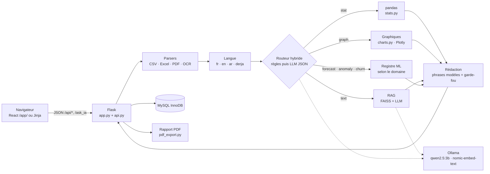
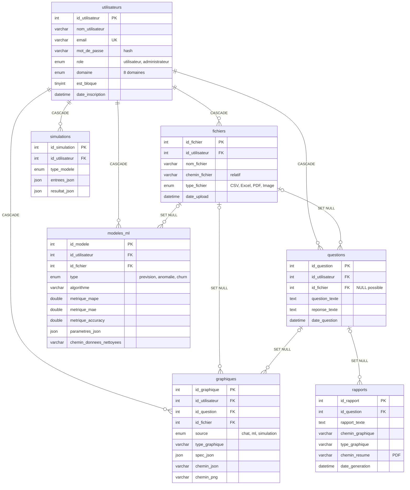

# DataIA — Architecture

> Document de référence technique. Pour **comprendre** le projet pas à pas, lire `GUIDE_COMPRENDRE_DATAIA.md` ; pour **l'installer**, `GUIDE_DEMARRAGE.md` ; pour les **raisons** de chaque choix, `JUSTIFICATIONS.md`.

## 1. Vue d'ensemble

DataIA est une application web d'analyse de données **100 % locale**. Une utilisatrice dépose un fichier (CSV, Excel, PDF ou image) et pose des questions en français, anglais, arabe ou derja. Le système répond avec des chiffres **calculés par pandas**, des graphiques, des modèles de Machine Learning adaptés à son domaine d'activité, et un rapport PDF.

**Principe central : le LLM comprend, le code calcule.** Le modèle de langage (Qwen2.5 3B, via Ollama) sert seulement à **classer** la question et à **rédiger** ; il n'écrit jamais un chiffre qui n'a pas été calculé par pandas ou par un modèle ML.



## 2. Composants

| Couche | Technologie | Fichiers |
|---|---|---|
| Interface principale | React 18 + Vite + Tailwind (fond blanc), Plotly.js 3.3.1 local | `frontend/src/` (compilé dans `frontend/dist`, servi sous `/app/`) |
| Interface de secours | Jinja2 (pages d'origine) | `templates/` |
| Serveur web | Flask 3, Flask-Login | `app.py` (pages Jinja, `/ask_ia`, export), `api.py` (API JSON `/api/*`, SPA) |
| Authentification | Flask-Login, mots de passe hachés (Werkzeug), sessions HttpOnly + SameSite=Lax | `services/auth.py` |
| Fichiers | upload contrôlé, chemins relatifs, propriété vérifiée | `services/fichiers.py` |
| Lecture des fichiers | pandas, charset-normalizer, openpyxl, pdfplumber, RapidOCR | `services/parsers.py`, `services/apercu.py` |
| Langue | détection fr / en / ar / derja, glossaire derja, noms propres arabes | `services/langue.py` |
| Routeur | règles par mots-clés puis LLM à sortie JSON contrainte | `services/router.py`, `services/prompts.py` |
| Sémantique | colonne mesurée, regroupement, période (déterministe) | `services/semantique.py` |
| Calcul | 10 opérations pandas en liste fermée (pas d'`eval`) | `services/stats.py` |
| Rédaction | phrases modèles en 3 langues, tableaux, provenance, garde-fou des nombres | `services/redaction.py` |
| Orchestration | une question → une réponse | `services/assistant.py` |
| RAG | FAISS + nomic-embed-text, recherche hybride | `services/rag.py`, `services/llm.py` |
| Graphiques | Plotly (11 variantes), PNG via kaleido + Chrome installé | `services/charts.py` |
| Machine Learning | Prophet, LightGBM, Isolation Forest, arbre de décision (Pipeline) | `services/ml/*.py` |
| Rapport PDF | fpdf2, Arial, arabic-reshaper, python-bidi | `services/pdf_export.py` |
| Base de données | MySQL 9.1 (WampServer), InnoDB, clés étrangères, migrations versionnées | `migrate.py`, `migrations/*.sql`, `services/db.py` |
| Configuration | `.env` + `config.py` (aucune valeur en dur) | `config.py`, `.env.example` |

## 3. Chemin d'une question (`POST /ask_ia`)

1. **Contrôle d'accès** : session valide (`@login_required`), le fichier appartient à l'utilisatrice (sinon 404).
2. **Lecture** (`parsers.analyser_fichier`, avec cache) : un ou plusieurs tableaux + du texte. `table_pour_question` choisit le tableau qui correspond à la question.
3. **Langue** (`langue.analyser_question`) : langue détectée, derja traduite en français, noms propres arabes translittérés (« تونس » → Tunis).
4. **Routage** (`router`) :
   - règles (graphique, prévision, anomalies, churn, export, superlatifs, listes de valeurs, questions de lecture) : 0 appel au LLM ;
   - sinon, le LLM renvoie un JSON imposé par un **schéma** (colonnes du fichier en `enum`) ;
   - validation : opération autorisée, colonnes existantes, **filtres ancrés dans la question**.
5. **Exécution** selon l'intent :
   - `stat` → `stats.py` (pandas) ;
   - `graph` → `charts.py` (pandas → figure Plotly) ;
   - `text` → `rag.recherche_hybride` puis LLM ;
   - `forecast` / `anomaly` / `churn` → `ml/registry.py` → `ml/executeur.py`, **seulement si le domaine de l'utilisatrice le permet** (sinon refus poli).
6. **Rédaction** (`redaction.py`) : phrase modèle, tableau Markdown, ligne « 🔢 Calculé par pandas… ». Une reformulation éventuelle par le LLM est rejetée si elle contient un nombre absent du résultat.
7. **Enregistrement** : ligne `questions` ; graphiques dans `graphiques` (JSON tout de suite, PNG en arrière-plan) ; modèle dans `modeles_ml` avec ses données nettoyées.
8. **Réponse JSON** : texte, intent, résultat structuré, suggestions, figures, temps par étape.

## 4. Modèles de Machine Learning par domaine

| Domaine | Prévision du CA | Anomalies | Churn |
|---|---|---|---|
| Banque | ✅ | ✅ | ✅ |
| E-commerce, Finance, Poste, Assurance, Télécom, Industrie, Autre | ✅ | ✅ | refus poli |

| Modèle | Algorithme | Fichier | Évaluation |
|---|---|---|---|
| Prévision | Prophet vs LightGBM vs référence naïve saisonnière ; le meilleur sur le test est retenu | `services/ml/forecast.py` | split **temporel**, MAE, RMSE, MAPE, sMAPE |
| Anomalies | Isolation Forest sur les colonnes transactionnelles + écart de cohérence ; seuil Q3 + 3 × IQR | `services/ml/anomalies.py` | anomalies injectées (`donnees_demo/`) |
| Churn | Pipeline OneHotEncoder + DecisionTreeClassifier (`max_depth=5`, `class_weight="balanced"`) | `entrainer_churn.py`, `services/ml/churn_banque.py` | rappel 76,7 %, précision 46,2 %, F1 0,576, AUC 0,840 |

Le **registre** (`services/ml/registry.py`) associe chaque domaine à ses modèles. Ajouter un modèle consiste à le déclarer dans `MODELES` et `MODELES_SPECIFIQUES` ; ni le routeur ni l'interface ne changent. Le **simulateur what-if** (`services/ml/simulateur.py`) génère ses formulaires à partir du fichier ou des features du modèle.

## 5. Base de données (`dataia`, InnoDB)



Tables techniques : `schema_migrations` (migrations appliquées) et `migration_orphelins` (39 questions dont le fichier n'existait plus, avec leur ancienne valeur, migration 001).

**Règle des clés étrangères** : `CASCADE` quand la ligne appartient à l'utilisatrice (supprimer le compte supprime ses données) ; `SET NULL` pour garder l'historique (supprimer un fichier garde les questions posées dessus).

**Migrations** (`python migrate.py`) : `mysqldump` vérifié dans `backups/`, puis application de chaque `migrations/NNN_*.sql` non encore appliqué, puis comparaison du nombre de lignes avant / après.

| Migration | Contenu |
|---|---|
| 001 | MyISAM → InnoDB, 7 clés étrangères, `domaine`, `modeles_ml`, `simulations`, orphelins |
| 002 | Table `graphiques` (3 clés étrangères) |
| 003 | `type_fichier` : CSV, Excel, PDF, Image |

## 6. API

Toutes les routes `/api/*` répondent en JSON. Celles qui modifient quelque chose (POST, PUT, DELETE) exigent un corps JSON (protection CSRF), sauf l'upload multipart, protégé par le cookie SameSite=Lax. Une requête non connectée reçoit **401** (pas de redirection) ; une ressource d'un autre compte renvoie **404**.

| Méthode | Route | Rôle |
|---|---|---|
| POST | `/api/signup`, `/api/login`, `/api/logout` | Compte (domaine obligatoire) ; déconnexion **en POST** |
| GET | `/api/me`, `/api/domaines` | Utilisatrice connectée ; liste des domaines |
| GET / PUT | `/api/profil` | Nom, domaine, modèles disponibles |
| GET | `/api/dashboard`, `/api/files` | Statistiques, fichiers |
| POST | `/api/upload` | Upload + aperçu + questions suggérées |
| GET / DELETE | `/api/files/<id>/apercu`, `/api/files/<id>` | Aperçu ; suppression |
| GET | `/api/chat/<id>/history` | Historique avec les figures |
| POST | `/ask_ia` | Poser une question |
| GET / POST | `/api/simulateur/modeles`, `/api/simulateur/<cle>` | Formulaires et simulation what-if |
| GET | `/api/simulations`, `/api/donnees_nettoyees` | Historique des simulations ; exports |
| GET | `/telecharger/nettoyees/<id>/<csv\|xlsx\|rapport>` | Données nettoyées (propriétaire ou admin) |
| POST | `/api/rapport/<id_fichier>/pdf` | Rapport PDF complet |
| GET / POST / PUT / DELETE | `/api/admin/...` | Administration (rôle administrateur) |
| GET | `/api/sante` | État d'Ollama et de MySQL |

## 7. Dossiers

```
DataIa/
├── app.py, api.py, config.py          serveur, API, configuration
├── migrate.py, migrations/            migrations de la base
├── entrainer_churn.py                 réentraînement du modèle churn
├── services/                          logique métier (voir §2)
│   └── ml/                            registre, prévision, anomalies, churn, nettoyage, simulateur
├── frontend/                          React (sources + dist compilé)
├── templates/, static/                interface Jinja de secours
├── tests/                             tests automatiques (tout_lancer.py) + e2e_final.py
├── donnees_demo/                      jeux synthétiques + corrigé des anomalies
├── mesures/                           mesures de temps et métriques (JSON) + résultats E2E
├── uploads/                           fichiers, index FAISS, graphiques, rapports (non versionné)
├── exports/donnees_nettoyees/U<id>/   données nettoyées par modèle (non versionné)
└── backups/                           sauvegardes mysqldump (non versionné)
```

## 8. Sécurité

| Risque | Protection |
|---|---|
| Exécution de code généré par le LLM | Aucun `eval` / `exec` : JSON contraint + liste fermée d'opérations |
| IDOR (accès au fichier d'un autre) | Propriété vérifiée partout (`fichier_de_utilisateur`) → 404 |
| Path traversal (`../../.env`) | Fichiers servis seulement depuis la base + dossier contrôlé (`commonpath`) |
| CSRF | JSON obligatoire sur l'API, SameSite=Lax, déconnexion en POST |
| Mots de passe | Hachés (Werkzeug), jamais renvoyés par l'API |
| Secrets | `.env` hors Git, `SECRET_KEY` aléatoire |
| Compte bloqué | Session coupée à la requête suivante |
| Données personnelles | LLM local : aucune donnée ne sort de la machine |
