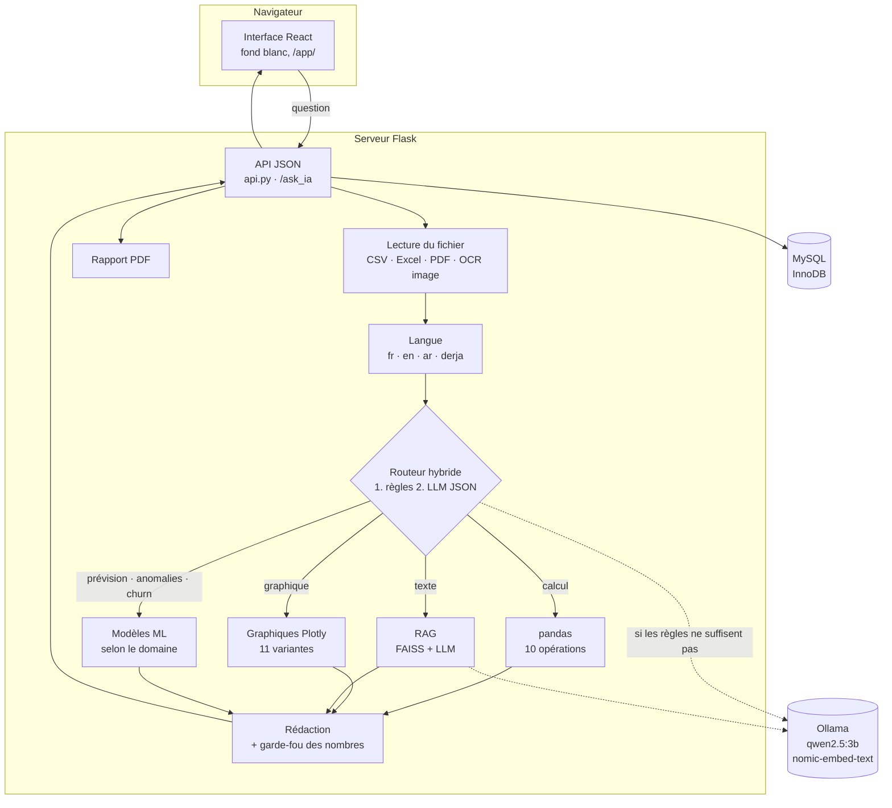

# Comprendre DataIA — le cours complet

> **À qui s'adresse ce document ?** À toi, qui dois présenter DataIA devant un jury et répondre à n'importe quelle question. On part de zéro : chaque mot technique est expliqué la première fois, et le **glossaire** (partie C) les reprend tous. Chaque phase suit le même plan : le problème de départ, la solution, les fichiers, les raisons du choix, le trajet réel d'une requête, les chiffres mesurés, comment le tester toi-même, puis les questions du jury.
>
> Documents complémentaires : `ARCHITECTURE.md` (référence technique), `JUSTIFICATIONS.md` (61 décisions argumentées), `CHANGELOG.md` (tout ce qui a changé, phase par phase), `GUIDE_DEMARRAGE.md` (installation).

## Sommaire

- **A. Vue d'ensemble** : ce que fait DataIA, l'idée centrale, le schéma
- **B. Les phases 0 à 9**
  - Phase 0 — L'audit de départ
  - Phase 1 — Un LLM local et multilingue
  - Phase 2 — Domaines d'activité et base de données solide
  - Phase 3 — Le routeur hybride : le LLM comprend, pandas calcule
  - Phase 4 — Des graphiques justes
  - Phase 5 — Trois modèles de Machine Learning
  - Phase 6 — Le nouveau frontend et le simulateur
  - Phase 7 — Lire les PDF et les images
  - Phase 8 — Le rapport PDF complet
  - Phase 9 — Test de bout en bout et documentation
- **C. Glossaire**
- **D. Les 3 modèles de Machine Learning en détail**
- **E. Limites et améliorations possibles**
- **F. Parcours de révision**

---

# A. Vue d'ensemble

## A.1 Ce que fait DataIA, en une phrase

Une utilisatrice dépose un fichier de données (Excel, CSV, PDF ou photo d'un tableau), pose une question **dans sa langue** (français, anglais, arabe ou derja) et obtient une **réponse chiffrée exacte**, un **graphique**, une **prévision**, une **détection d'anomalies** ou un **score de départ des clients** selon son métier, puis un **rapport PDF**. Tout fonctionne **sur l'ordinateur, sans Internet** : aucune donnée ne sort de la machine.

## A.2 L'idée centrale (à retenir avant tout le reste)

> **Le LLM comprend, le code calcule.**

Un **LLM** (*Large Language Model*, grand modèle de langage, comme ChatGPT) est très bon pour **comprendre une phrase** et **écrire du texte**, mais **mauvais en calcul** : il prédit le mot le plus probable, il ne fait pas d'addition. Si on lui demande « quel est le total des ventes ? », il produit un nombre **plausible**, pas un nombre **juste**.

C'est exactement ce qui se passait au début du projet : sur un fichier sans colonne de ventes, DataIA répondait **105.00** en français et **106.20 dinars** en arabe. Deux chiffres différents, et tous deux **inventés**.

La solution de DataIA :
1. le LLM **lit** la question et dit **quoi** calculer (« une somme, sur la colonne chiffre d'affaires, avec le filtre région = Tunis ») ;
2. **pandas** (la bibliothèque Python de calcul sur les tableaux) fait le calcul **exact** ;
3. le texte de réponse est construit par du code avec le nombre de pandas, et un **garde-fou** refuse toute phrase du LLM qui contiendrait un autre nombre.

Résultat : le même chiffre dans les 4 langues, et le chiffre juste.

## A.3 Le schéma



## A.4 Les briques, avec des mots simples

| Brique | Ce que c'est | Analogie |
|---|---|---|
| **Flask** | Le serveur web en Python | Le guichet qui reçoit les demandes |
| **React** | L'interface dans le navigateur | La vitrine |
| **MySQL** | La base de données (comptes, fichiers, questions…) | Les archives |
| **Ollama** | Le programme qui fait tourner le LLM sur le PC | Le traducteur sur place |
| **Qwen2.5 3B** | Le LLM (3 milliards de paramètres) | Le traducteur lui-même |
| **pandas** | Le calcul sur les tableaux | La calculatrice |
| **FAISS** | La recherche de textes proches | Le documentaliste |
| **Plotly** | Les graphiques | Le dessinateur |
| **Prophet, LightGBM, Isolation Forest, arbre de décision** | Les modèles de Machine Learning | Les experts spécialisés |

## A.5 Les chiffres clés à connaître

| Mesure | Avant | Après |
|---|---|---|
| Réponses exactes sur 6 questions de test | 0 / 6 | **6 / 6** |
| Temps moyen d'une question de calcul | 61,3 s | **11,2 s** (÷ 5,5) |
| Graphique « CA par région » | 65 à 75 s, valeurs fausses | **0,39 s**, valeurs exactes |
| Taille du prompt envoyé au LLM | ~2 080 tokens | **~680 tokens** |
| Prévision du CA (`ventes_demo`) | — | MAPE **9,7 %** (référence naïve : 22,5 %) |
| Anomalies (8 injectées) | — | **7 détectées**, 0 fausse alerte, la 8ᵉ dans « à surveiller » |
| Churn (2 000 clients de test) | — | rappel **76,7 %**, AUC **0,840** |
| Rapport PDF complet | texte seul, arabe supprimé | **2,3 s**, graphiques + ML + arabe |

---

# B. Les phases

## Phase 0 — L'audit de départ

### Le problème de départ
Avant de modifier quoi que ce soit, il fallait **savoir ce qui existait** et ce qui ne marchait pas. Le projet d'origine était une application Flask avec un chatbot qui appelait l'**API Mistral** (un LLM en ligne, payant), quelques pages Jinja et une base MySQL.

L'exemple qui résume tout : sur `produits_magasin.csv` (5 produits, colonnes `price` et `stock_quantity`, **aucune colonne de ventes**), la question « Quel est le total des ventes ? » donnait **105.00** en français et **106.20 dinars** en arabe. Le LLM inventait.

### Ce qu'on a fait
On a lu tout le code, interrogé la base réelle (`SHOW CREATE TABLE`), lancé l'application et listé les problèmes, sans rien modifier :

| Catégorie | Constat |
|---|---|
| Exactitude | Le LLM « calcule » à partir de 8 lignes sur 1 000 (RAG) : chiffres inventés, différents selon la langue |
| Confidentialité | Les lignes des fichiers partaient chez Mistral ; clé API écrite dans le code |
| Sécurité | IDOR sur `/ask_ia`, *path traversal* sur `/view_report`, routes admin sans contrôle du rôle, `SECRET_KEY` en dur, `debug=True` |
| Base | Tables en **MyISAM** (clés étrangères ignorées) → 39 questions orphelines |
| Fonctionnel | Pas de domaine d'activité, déconnexion incomplète, pas de bouton sur la page admin, graphiques dessinés avec des valeurs écrites par le LLM, export PDF sans l'arabe |
| Environnement | venv qui pointait vers un ancien dossier sur `C:`, `requirements.txt` incompatible |

### Pourquoi commencer par un audit
Chaque phase suivante corrige un problème **constaté et mesuré**, pas supposé. C'est aussi ce qui permet de présenter des chiffres « avant / après ».

### Questions du jury
1. **« Pourquoi ne pas avoir tout réécrit ? »** — Les fonctions existantes (comptes, upload, historique, admin, PDF) marchaient et devaient continuer à marcher. On a remplacé brique par brique, avec des tests de non-régression à chaque phase.
2. **« Comment avez-vous trouvé les failles ? »** — En lisant chaque route et en se demandant : « qui a le droit d'appeler ça, et qu'est-ce qui est vérifié ? ». Puis chaque faille a été reproduite par un test avant d'être corrigée.
3. **« Pourquoi les tables étaient-elles en MyISAM alors que `database.sql` disait InnoDB ? »** — Le fichier du dépôt ne correspondait pas à la base réelle (sans doute créée depuis phpMyAdmin). D'où la règle : toujours vérifier la base elle-même.
4. **« Quelle était la cause des chiffres faux ? »** — Le RAG ne donne au LLM que quelques lignes, et un LLM ne sait pas additionner. Ce n'est pas un réglage à corriger, c'est l'architecture qu'il fallait changer (Phase 3).
5. **« Qu'avez-vous mis en place avant de toucher au code ? »** — Une branche Git `dataia-v2` (un commit par phase), une sauvegarde `mysqldump` avant toute modification de la base, et la règle « pas de configuration en dur ».

---

## Phase 1 — Un LLM local et multilingue

### Le problème de départ
- Les questions et les lignes des fichiers partaient chez **Mistral** (des données confidentielles de banque, par exemple).
- La clé API, le mot de passe MySQL et la `SECRET_KEY` étaient **écrits dans le code**.
- Une question en arabe pouvait **faire planter** le serveur (la console Windows ne savait pas afficher l'arabe).
- Plusieurs failles de sécurité (voir Phase 0).

### Ce qu'on a fait
1. **LLM local avec Ollama** : le modèle `qwen2.5:3b` tourne sur le PC, et `nomic-embed-text` sert aux *embeddings* (voir glossaire).
2. **Détection de la langue par règles** (fr / en / ar / derja) et un **glossaire derja** d'environ 150 mots. La réponse est en français pour la derja en lettres latines, en arabe standard pour la derja en lettres arabes.
3. **Configuration** dans `.env` (non versionné), lue une seule fois par `config.py` ; `.env.example` documente chaque variable.
4. **8 corrections de sécurité** : IDOR, path traversal, `@admin_required`, `SECRET_KEY` aléatoire, `debug=False`, noms de fichiers uniques, compte bloqué déconnecté immédiatement.
5. **Ollama arrêté → message clair** (code 503) au lieu d'une page d'erreur.

### Les fichiers
| Fichier | Fonctions importantes |
|---|---|
| `services/llm.py` | `ChatOllama` (température 0), `NomicEmbeddings` (préfixes `search_document:` / `search_query:`), `verifier_ollama()`, `OllamaIndisponibleError` |
| `services/rag.py` | index FAISS par fichier : construction, chargement (avec contrôle de la dimension 768), recherche, suppression |
| `services/langue.py` | `analyser_question()` → langue, langue de réponse, question traduite |
| `config.py` + `.env` | toutes les valeurs de configuration |
| `app.py` | `/ask_ia` réécrite, `/api/sante`, `/view_report` sécurisée |

### Pourquoi ces choix
| Choix | Alternatives écartées |
|---|---|
| LLM local (Ollama) | API Mistral / OpenAI : données envoyées à un tiers, coût, Internet obligatoire |
| Qwen2.5 3B | Modèles 7B : trop lents sur ce PC (8 Go de RAM) ; d'autres modèles 3B sont moins bons en arabe |
| Détection de langue par règles | Par le LLM : lent, et le 3B ne reconnaît pas la derja (il l'a prise pour du **wolof**) |
| FAISS | Chroma, Milvus : un serveur ou des dépendances en plus pour le même résultat |

### Le trajet d'une requête (Phase 1)
« شنوة المنتوجات اللي فما في الملف؟ » (« quels produits y a-t-il dans le fichier ? ») :
1. `langue.analyser_question` voit des lettres arabes et des marqueurs derja (`شنوة`, `فما`) → langue **derja arabe**, réponse en **arabe standard** ;
2. le glossaire remplace les mots derja par de l'arabe standard ;
3. contrôle : le fichier appartient bien à l'utilisatrice ;
4. RAG : recherche des lignes proches dans FAISS, puis prompt au LLM avec la consigne « réponds en arabe » ;
5. réponse, avec un avertissement écrit à la main : « la derja est comprise, mais la réponse est en arabe standard ».

### Résultats mesurés
- 13 phrases de test : **13 / 13** langues bien détectées.
- Réponses dans la bonne langue pour les 5 cas (fr, en, ar, derja latine, derja arabe), mais **34 à 88 s par réponse** sur CPU : c'est ce qui a motivé la Phase 3.
- Tests Phase 1 : **20 / 20** (21 / 21 aujourd'hui).

### Tester toi-même
- Arrête Ollama, puis pose une question : tu dois voir « le service d'IA est indisponible » (et pas une page d'erreur).
- Connecte-toi avec un compte A, puis appelle `/ask_ia` avec le `file_id` d'un fichier du compte B : réponse **404**.
- `python tests/integration_phase1.py`.

### Questions du jury
1. **« Pourquoi un modèle local, alors qu'une API est meilleure ? »** — Confidentialité (rien ne sort de la machine), pas de coût, fonctionne sans Internet. La qualité moindre est compensée par l'architecture : le LLM ne calcule plus (Phase 3).
2. **« Votre application parle derja ? »** — Elle **comprend** les questions courantes grâce au glossaire, mais répond en français ou en arabe standard : le modèle 3B ne sait pas écrire la derja, et on préfère le dire.
3. **« Qu'est-ce qu'une faille IDOR ? »** — L'application faisait confiance à l'identifiant envoyé par le navigateur : en changeant `file_id`, on lisait le fichier d'un autre. Maintenant, chaque requête vérifie `id_utilisateur`.
4. **« Pourquoi `temperature = 0` ? »** — Pour que la même question donne la même réponse : on veut un assistant **reproductible**, pas créatif.
5. **« Pourquoi ne pas laisser la `SECRET_KEY` dans le code ? »** — Elle signe les cookies de session. Si elle est publique (sur GitHub), n'importe qui peut fabriquer un cookie « administrateur ».
6. **« Que se passe-t-il si Ollama plante pendant la démo ? »** — L'utilisatrice reçoit un message clair dans sa langue (503). Les calculs, graphiques et modèles ML qui ne passent pas par le LLM continuent de marcher.

---

## Phase 2 — Domaines d'activité et base de données solide

### Le problème de départ
- Aucune notion de **métier** : une banque et un site e-commerce voyaient exactement la même chose.
- Tables en **MyISAM** : les clés étrangères étaient ignorées, d'où **39 questions** qui pointaient vers des fichiers supprimés.
- Déconnexion incomplète (une partie de la session restait), pas de bouton sur la page admin, et la touche « Précédent » réaffichait une page protégée.

### Ce qu'on a fait
1. Colonne **`domaine`** (8 valeurs : Banque, E-commerce, Finance, Poste, Assurance, Télécom, Industrie, Autre), obligatoire à l'inscription, modifiable dans le profil et par l'admin.
2. **Migration 001** : MyISAM → **InnoDB**, 7 **clés étrangères**, nouvelles tables `modeles_ml`, `simulations`, `migration_orphelins` et `schema_migrations`.
3. **Aucune perte de données** : les 39 orphelins ont reçu `id_fichier = NULL`, et leur ancienne valeur est gardée dans `migration_orphelins`.
4. **`migrate.py`** : sauvegarde `mysqldump` vérifiée, puis migration, puis comparaison du nombre de lignes. La migration a d'abord été répétée sur une copie de la base.
5. Déconnexion : `logout_user()` + `session.clear()` + `Cache-Control: no-store` + un bouton sur toutes les pages.

### Les fichiers
`migrate.py`, `migrations/001_phase2_innodb_domaine_ml.sql`, `services/domaines.py`, `templates/profil.html`, `app.py` (`/signup`, `/profil`, `/admin/set_domaine`, `/logout`).

### Pourquoi ces choix
| Choix | Alternatives |
|---|---|
| InnoDB | MyISAM : pas de clés étrangères, pas de transactions, verrou sur toute la table |
| `SET NULL` sur `questions.id_fichier` | `CASCADE` : supprimer un fichier effacerait l'historique des questions |
| Orphelins → NULL + table de trace | Supprimer les 39 questions (perte) ; créer de faux fichiers (fausse donnée) |
| `domaine` en ENUM | Table `domaines` + clé étrangère : plus souple, mais inutile pour une liste fixe |
| Migrations numérotées + `schema_migrations` | Modifier la base à la main dans phpMyAdmin : non reproductible, aucune trace |

### Le trajet d'une requête : l'inscription
`POST /api/signup` avec `domaine = "Banque"` → `domaine_valide()` vérifie la liste (le domaine « Pirate » est refusé, testé) → le mot de passe est haché → `INSERT` → MySQL vérifie à son tour l'ENUM. Il y a deux barrières : l'application **et** la base.

### Résultats mesurés
- Lignes avant / après la migration : utilisateurs 7 = 7, fichiers 6 = 6, questions 64 = 64, rapports 8 = 8 ; **comparaison colonne par colonne : 0 différence**.
- 39 / 39 orphelins retrouvés avec leur valeur exacte.
- Tests Phase 2 : **33 / 33**.

### Tester toi-même
- Crée un compte, puis supprime un fichier sur lequel tu as posé des questions : les questions restent (dans phpMyAdmin, `id_fichier` vaut NULL).
- Déconnecte-toi puis appuie sur « Précédent » : tu reviens sur la page de connexion.
- `python migrate.py --statut`.

### Questions du jury
1. **« Comment garantissez-vous qu'une migration ne perd rien ? »** — Sauvegarde vérifiée avant, essai sur une copie, comptage des lignes avant / après, comparaison colonne par colonne, et restauration testée.
2. **« Pourquoi CASCADE pour certaines clés et SET NULL pour d'autres ? »** — CASCADE quand la donnée **appartient** à l'utilisatrice (son compte disparaît, ses données aussi) ; SET NULL quand on veut **garder l'historique** (un fichier supprimé ne doit pas effacer les questions).
3. **« À quoi sert le domaine ? »** — À choisir les modèles ML proposés : prévision et anomalies pour tous, churn en plus pour la Banque.
4. **« Pourquoi valider le domaine côté serveur alors que c'est une liste déroulante ? »** — Parce qu'on peut envoyer une requête à la main sans passer par le formulaire : le serveur ne doit jamais faire confiance au navigateur.
5. **« Qu'est-ce que la table `schema_migrations` ? »** — Le registre des migrations déjà appliquées. `migrate.py` n'applique que les nouvelles, dans l'ordre, et une installation neuve se reconstruit à l'identique (`database.sql` + `migrate.py`, testé).
6. **« Pourquoi `Cache-Control: no-store` ? »** — Sans lui, après une déconnexion, le navigateur peut réafficher une page protégée depuis son cache quand on clique sur « Précédent ».

---

## Phase 3 — Le routeur hybride : le LLM comprend, pandas calcule

C'est **la phase la plus importante** : c'est elle qui rend les réponses justes.

### Le problème de départ
Le cas réel : `produits_magasin.csv` (5 produits : `product_id, product_name, category, price, stock_quantity`). **Il n'y a aucune colonne de ventes.**

| Question | Réponse avant |
|---|---|
| « Quel est le total des ventes ? » | **105.00** (observé), puis « 150 » à la relance |
| « ما هو مجموع المبيعات؟ » | **106.20 دينار** (observé), puis « 100.30 دينار » |

Aucun de ces nombres ne correspond à un calcul possible. Pourquoi ? Le **RAG** (voir glossaire) donnait au LLM **8 lignes sur 1 000** ; un total porte sur toutes les lignes, et un LLM ne sait pas additionner : il produit un chiffre **plausible**.

### Ce qu'on a fait
Chaque question suit 4 étapes :

1. **Règles par mots-clés** (`router.py`) : « graphique / chart / رسم », « prévision / توقع », « anomalie / fraude », « churn / quitter la banque », « la plus forte / le plus vendu » (superlatif), « quelles sont les régions ? » (liste de valeurs), « que dit le rapport… » (lecture). Si une règle s'applique, il n'y a **aucun appel au LLM**.
2. Sinon, le **LLM classe la question** et renvoie un **JSON imposé par un schéma** : `{"intent": "stat", "operation": "sum", "colonne": "chiffre_affaires", "filtres": [...]}`. Les colonnes sont une **liste fermée** (`enum`) construite à partir du fichier : le LLM ne peut **pas** écrire une colonne qui n'existe pas.
3. **Validation** : opération dans une liste fermée (`sum, mean, median, count, min, max, top, groupby, trend, percentage`), colonnes vérifiées, et **filtres ancrés** (un filtre n'est gardé que si sa valeur est **écrite dans la question**).
4. **`semantique.py`** décide **par règles**, de la même façon dans toutes les langues, quelle colonne correspond à « ventes » (`chiffre_affaires`, `Total_Price`…), le regroupement (« par région », « حسب المنطقة ») et la période (« par mois »).

Puis **pandas** calcule et **`redaction.py`** écrit la réponse avec une **phrase modèle**. Une ligne de **provenance** est toujours ajoutée : « 🔢 Calculé par pandas — opération `sum` · colonne `Total_Price` · 1 000 lignes sur 1 000 ».

**Quand « ventes » n'existe pas**, le système **demande une précision**, en montrant les options calculées :

| Option | Total |
|---|---|
| `price` | 10,7 |
| `stock_quantity` | 275 |
| `price × stock_quantity` | 424 |

C'est la même réponse en français, anglais, arabe et derja.

### Les fichiers
| Fichier | Rôle |
|---|---|
| `services/router.py` | `intent_par_regles`, appel LLM `generer_json`, `valider_plan` |
| `services/prompts.py` | prompt court (colonnes + types + 3 lignes) et `schema_routeur` (JSON schema) |
| `services/semantique.py` | concepts (ventes / quantité / prix), regroupement, période, `mesure_par_defaut` |
| `services/stats.py` | les 10 opérations pandas, les filtres, la conversion robuste des nombres et des dates |
| `services/redaction.py` | phrases en 3 langues, tableaux, provenance, demande de précision, **garde-fou** |
| `services/assistant.py` | `repondre()` : orchestration et mesure des temps |

### Pourquoi ces choix
| Choix | Alternative écartée | Raison |
|---|---|---|
| JSON contraint par une grammaire | Laisser le LLM écrire du code pandas (`eval`/`exec`, PandasAI) | **Faille de sécurité** : un fichier piégé peut faire exécuter n'importe quel code ; et un 3B écrit souvent du code faux |
| Liste fermée d'opérations | Du SQL généré | Même risque (injection), et les données sont dans des fichiers |
| Règles avant le LLM | Tout passer au LLM | « graphique » ne laisse aucun doute : 0 s au lieu de 5 à 20 s |
| Demande de précision | Choisir `price × stock` automatiquement | Ce serait une supposition. Une question en plus vaut mieux qu'un chiffre faux |
| Garde-fou des nombres | Faire confiance à la reformulation | Le LLM pourrait réécrire « 424 » en « 425 » |

### Le trajet réel d'une requête
« Quel est le chiffre d'affaires total à Tunis ? » sur `ventes_demo_dataia.xlsx` :
1. `app.py /ask_ia` : session valide, le fichier appartient à l'utilisatrice ;
2. `parsers.analyser_fichier` lit l'Excel (avec cache) ;
3. `langue.analyser_question` : français ;
4. `router` : aucune règle évidente → LLM JSON → `{"intent":"stat","operation":"sum","colonne":"chiffre_affaires","filtres":[{"colonne":"region","operateur":"==","valeur":"Tunis"}]}` ;
5. validation : « Tunis » est bien écrit dans la question → filtre gardé ;
6. `stats.py` : `df[df.region == "Tunis"].chiffre_affaires.sum()` ;
7. `redaction.py` : « **Total de `chiffre_affaires`** (region = Tunis) : **…** » + provenance ;
8. enregistrement dans `questions`, puis réponse JSON au navigateur.

### Résultats mesurés (6 mêmes questions, même machine)
| | Avant | Après |
|---|---|---|
| Réponses exactes | **0 / 6** | **6 / 6** |
| Temps moyen | 61,3 s | **11,2 s** (÷ 5,5) |
| Tokens du prompt | ~2 080 | **~680** |
| « Quelles sont les régions ? » | 42 à 69 s, 4 régions sur 5 | **0,04 s**, 5 / 5, sans LLM |

Les 5 optimisations de vitesse, mesurées :
1. prompt réduit (colonnes + types + 3 lignes, au lieu de `describe()`) : 2 640 → 730 tokens ;
2. **CPU au lieu du GPU** (`OLLAMA_NUM_GPU=0`) : 3,2 → **8,7 tokens/s**, car la MX130 (2 Go) ne contient qu'une partie du modèle ;
3. **`127.0.0.1` au lieu de `localhost`** : 2,3 s → 0,3 s par connexion (Windows essaie d'abord IPv6) ;
4. pas d'appel LLM inutile (règles, pas de reformulation des tableaux) ;
5. `keep_alive=30m` + préchauffage : le modèle reste en mémoire.

### Tester toi-même
- Sur `tests/donnees/produits_magasin.csv` : « Quel est le total des ventes ? » → demande de précision avec 10,7 / 275 / 424. Clique sur la 3ᵉ suggestion → **424**.
- La même question en arabe : **les mêmes options**.
- `python -m unittest tests.test_routeur_hybride -v`.

### Questions du jury
1. **« Qu'est-ce qui empêche le LLM de faire n'importe quoi ? »** — Trois barrières : la grammaire d'Ollama (JSON valide, colonnes existantes), la validation Python (opération autorisée, filtres ancrés), et l'absence de toute exécution de code (chaque opération est une fonction écrite à l'avance).
2. **« Pourquoi ne pas laisser le LLM écrire du code pandas, comme PandasAI ? »** — Exécuter du code généré, c'est donner au fichier ou à la question le pouvoir d'exécuter n'importe quoi sur le serveur. C'était interdit par le cahier des charges, et un modèle 3B écrit souvent du code faux.
3. **« Le LLM sert encore à quoi ? »** — À comprendre les questions ouvertes (« combien de factures Pending en mars ? »), à répondre aux questions de texte (RAG) et à rédiger une phrase naturelle, sous contrôle du garde-fou.
4. **« Pourquoi la même réponse dans toutes les langues ? »** — Le calcul ne dépend pas de la langue : la langue ne change que la phrase autour du nombre. `semantique.py` résout « ventes », « sales » et « المبيعات » vers la même colonne.
5. **« Qu'est-ce qu'un filtre ancré ? »** — Un filtre dont la valeur est écrite dans la question. Un jour, le LLM a ajouté `Status == Pending`, recopié d'un exemple du prompt. Depuis, un filtre non ancré est rejeté **et signalé** dans la réponse.
6. **« Pourquoi le GPU n'est pas utilisé ? »** — On l'a mesuré : la MX130 de 2 Go ne contient qu'une partie du modèle, et les allers-retours CPU ↔ GPU rendent la génération 2,7 fois plus lente.
7. **« Que fait le garde-fou des nombres ? »** — Chaque nombre de la phrase du LLM doit correspondre (à 0,5 % près) à une valeur de pandas ou de la question, sinon la phrase est rejetée et on garde la phrase modèle. Testé : « 105,00 » est rejeté, « ٤٢٤ » (424 en chiffres arabes) est accepté.

---

## Phase 4 — Des graphiques justes

### Le problème de départ
Les graphiques étaient dessinés à partir d'un JSON **écrit par le LLM** (`{"type_graph": "pie", "data": {"x": [...], "y": [...]}}`). Les valeurs étaient donc inventées : pour « CA par région », le camembert n'affichait que **2 régions sur 5**, avec de faux montants, et il fallait **65 à 75 s**. Le CDN chargeait en plus une version de Plotly de 2021.

### Ce qu'on a fait
- **Le LLM ne dessine plus rien.** `charts.py` reconnaît par règles le type demandé (camembert, barres, courbe…) et les colonnes. Le LLM n'intervient que si un axe n'est pas précisé, et seulement avec une sortie JSON contrainte.
- **pandas calcule les données** (groupby, pivot, corrélations), puis Plotly construit la figure.
- **9 types (11 variantes)** : barres, barres groupées, barres empilées, courbe, aire, camembert, donut, nuage de points, histogramme, boîte à moustaches, heatmap.
- **Type demandé mais inadapté** (une courbe sans date, un camembert avec des valeurs négatives, un nuage avec une seule colonne numérique) : le système l'**explique** et propose un type adapté (« une courbe a besoin d'une date ; voici des barres à la place »).
- **Choix automatique expliqué** quand aucun type n'est demandé : date + nombre → courbe ; ≤ 6 catégories → camembert ; plus de 6 → barres ; 2 nombres → nuage ; ≥ 3 nombres → heatmap.
- **PNG** pour le PDF via **kaleido**, avec le **Chrome déjà installé** (rien de téléchargé), en arrière-plan.
- Table **`graphiques`** (migration 002) : chaque figure est enregistrée en JSON ; l'historique du chat réaffiche les graphiques.

### Les fichiers
`services/charts.py` (`generer`, `construire_spec`, `_choisir_type`, `construire_figure`, `exporter_png`, `enregistrer`, `nettoyer_ancien_format`), `migrations/002_phase4_graphiques.sql`, `templates/chat.html`, `/vendor/plotly.min.js` (plotly.js 3.3.1 servi en local).

### Pourquoi ces choix
| Choix | Alternative | Raison |
|---|---|---|
| Plotly | matplotlib, Recharts | Graphiques interactifs dans le navigateur **et** PNG pour le PDF à partir de la même figure |
| Type et colonnes par règles | Tout demander au LLM | 0,47 s au lieu de 9 à 15 s, et pas d'erreur de colonne |
| Chrome installé | Télécharger un Chromium pour kaleido | Pas de téléchargement de 150 Mo, ni de second navigateur |
| Graphique à la demande | Graphiques automatiques à l'upload | Calculs inutiles sur une machine de 8 Go ; l'utilisatrice décide |

### Le trajet d'une requête
« Montre les ventes par région en camembert » → règle `graph` (pas de LLM) → `charts.generer` : type `pie` demandé, X = `region` (le mot « région »), Y = `chiffre_affaires` (concept « ventes ») → pandas `groupby("region").sum()` → contrôle : valeurs négatives ? (si oui, on passe aux barres) → figure Plotly → JSON au navigateur + ligne `graphiques` → PNG en arrière-plan.

### Résultats mesurés
- **CA par région : 65 à 75 s, valeurs fausses → 0,39 s, valeurs exactes.**
- Graphique sans LLM : **0,47 s** en moyenne (14 demandes sur 15) ; avec le LLM : ~9 s.
- PNG : ~4 s pour le premier (démarrage de Chrome), puis ~0,4 s.
- Tests : chaque valeur dessinée est **recalculée par pandas dans le test** et comparée à la figure (17 tests).

### Tester toi-même
- « courbe des ventes par région » → explication : il n'y a pas de date, donc des barres à la place.
- « heatmap de corrélation » → les identifiants (`id_vente`) sont exclus.
- `python -m unittest tests.test_graphiques -v`.

### Questions du jury
1. **« Comment prouvez-vous que le graphique est juste ? »** — Le test recalcule chaque valeur avec pandas, indépendamment, et la compare à la figure produite.
2. **« Pourquoi refuser un camembert ? »** — Un camembert représente des parts d'un total. Avec des valeurs négatives (un CA négatif = un remboursement), une « part négative » n'a pas de sens. On l'explique et on montre des barres.
3. **« Pourquoi plotly.js en local ? »** — Pour fonctionner sans Internet, et parce que le CDN `plotly-latest` restait figé sur une version de 2021.
4. **« Le graphique en arabe est-il le même ? »** — Oui : même type, mêmes axes, mêmes valeurs ; seuls les titres changent (testé dans les 4 langues).
5. **« Pourquoi enregistrer les graphiques en base ? »** — Pour les réafficher dans l'historique et les mettre dans le rapport PDF sans tout recalculer.

---

## Phase 5 — Trois modèles de Machine Learning

### Le problème de départ
DataIA ne faisait que décrire le passé. Les besoins métier sont différents selon le domaine : **prévoir** le chiffre d'affaires, **repérer** des transactions anormales, et pour une banque, **identifier les clients qui risquent de partir** (*churn*). Le modèle churn fourni utilisait `pd.get_dummies` **en dehors** du modèle, ce qui casse dès qu'un fichier ne contient pas tous les pays.

### Ce qu'on a fait
- Un **registre** (`registry.py`) : prévision et anomalies pour tous les domaines, churn pour la Banque. Hors domaine, le système **refuse poliment** et liste les modèles disponibles.
- **Prévision** : Prophet **et** LightGBM sont entraînés, comparés à une **référence naïve**, et le meilleur sur le test est retenu (détails en partie D).
- **Anomalies** : Isolation Forest sur les colonnes de transaction, avec un « écart de cohérence » (montant ≠ quantité × prix) et un seuil robuste.
- **Churn** : réentraîné en **Pipeline** (encodage + arbre de décision), avec `max_depth` choisi par validation croisée.
- **Nettoyage traçable** : chaque modèle exporte les données qu'il a **réellement reçues** (CSV + Excel + rapport de nettoyage), téléchargeables.
- **Données de démo synthétiques** avec des anomalies injectées et leur corrigé.

### Les fichiers
`services/ml/registry.py`, `forecast.py`, `anomalies.py`, `churn_banque.py`, `nettoyage.py`, `executeur.py`, `entrainer_churn.py`, `donnees_demo/`, `templates/mes_donnees.html`.

### Pourquoi ces choix (résumé ; détail en partie D)
| Besoin | Choix | Écartés |
|---|---|---|
| Prévoir | Prophet vs LightGBM + référence naïve | ARIMA (réglages instables sur 24 mois) ; un seul modèle (aucun ne gagne partout) |
| Anomalies | Isolation Forest | Z-score (une colonne, sensible aux anomalies), K-Means (fait des groupes), DBSCAN (réglages sensibles) |
| Churn | Arbre de décision en Pipeline | Réseau de neurones (pas mieux sur 10 000 lignes, pas explicable) |

### Le trajet d'une requête
« Prévois le chiffre d'affaires des 6 prochains mois » → règle `forecast` → le registre vérifie que le domaine y a droit → `forecast.py` : colonnes date + CA, nettoyage, exclusion des valeurs aberrantes, agrégation mensuelle, retrait des mois incomplets, split temporel, Prophet vs LightGBM vs référence naïve, choix sur la MAPE, réentraînement sur toute la série, prévision + intervalle → `executeur.py` : export des données nettoyées, ligne `modeles_ml`, réponse en 3 langues avec le tableau comparatif et le graphique.

### Résultats mesurés
| Modèle | Fichier | Résultat |
|---|---|---|
| Prévision | `ventes_demo_dataia.xlsx` | LightGBM retenu, MAPE **9,7 %** (Prophet 17,9 %, référence naïve 22,5 %) |
| Prévision | `demo_ventes_synthetique.csv` | Prophet retenu, MAPE **11,6 %** (LightGBM 26,1 %) |
| Anomalies | `ventes_demo_dataia.xlsx` (8 injectées) | **7 / 8** détectées, 0 fausse alerte ; la 8ᵉ en tête de « à surveiller » |
| Churn | 2 000 clients de test | rappel **76,7 %**, précision 46,2 %, F1 0,576, AUC 0,840 |
| Temps | | prévision 0,5 s (4,6 s la 1ʳᵉ fois), anomalies 2,5 s, churn 0,2 s |

Problème trouvé et corrigé : **une seule vente de 106 549** (une anomalie volontaire) faisait passer la MAPE de LightGBM à **24,5 %**. Après exclusion documentée des valeurs aberrantes : **9,7 %**.

### Tester toi-même
- Compte Banque + `donnees_demo/demo_clients_banque_synthetique.csv` : « Quels clients risquent de partir ? ».
- Compte E-commerce, même question → refus poli.
- `donnees_demo/demo_transactions_anomalies_REPONSES.csv` contient le corrigé des anomalies injectées.
- `python -m unittest tests.test_ml -v`.

### Questions du jury
1. **« Pourquoi deux modèles de prévision ? »** — Aucun n'est le meilleur partout : sur trois fichiers, Prophet gagne une fois et LightGBM deux fois. On compare sur les mêmes mois de test, et on garde le meilleur.
2. **« Pourquoi une référence naïve ? »** — Pour savoir si le modèle apporte vraiment quelque chose. Un modèle moins bon que « même valeur qu'il y a un an » ne sert à rien.
3. **« Une anomalie, c'est une erreur ? »** — Non, c'est une ligne **inhabituelle**. Le système explique pourquoi (« CA = −350 au lieu de 1 608 »), et l'humain décide.
4. **« L'accuracy du churn (77 %) est plus basse que celle d'un modèle naïf (79,65 %) : c'est un échec ? »** — Non. Le modèle naïf dit « tout le monde reste » et ne détecte **aucun** départ. Ce qui compte pour une banque, c'est le **rappel** : 76,7 % des départs sont détectés.
5. **« Pourquoi un Pipeline ? »** — L'encodage des pays fait partie du modèle sauvegardé : il est appliqué à l'identique à la prédiction, même si le fichier ne contient que des clients français.
6. **« Comment savez-vous ce que le modèle a reçu ? »** — Les données nettoyées exactes sont téléchargeables avec leur rapport (lignes avant / après, valeurs remplacées, exclusions).

---

## Phase 6 — Le nouveau frontend et le simulateur

### Le problème de départ
Les pages Jinja étaient fonctionnelles mais datées. Un frontend React existait déjà à côté du projet, mais il n'était branché sur rien. Il manquait aussi un moyen de **jouer** avec les modèles (« et si ce client avait 55 ans ? »).

### Ce qu'on a fait
- **Architecture « SPA + API »** : React (fond blanc) dialogue avec Flask uniquement par une **API REST JSON** (`/api/*`). Flask sert le build React sous `/app/`. Les pages Jinja restent disponibles **en secours**.
- **Sécurité de l'API** : les POST / PUT / DELETE exigent du JSON (protection **CSRF**), le cookie est **SameSite=Lax** et HttpOnly, la déconnexion se fait **en POST**, une requête non connectée reçoit **401** en JSON, et un objet d'un autre compte renvoie 404.
- **Simulateur what-if** : un panneau à droite du chat, avec des formulaires **générés automatiquement** (colonnes du fichier pour la prévision et les anomalies, features du modèle pour le churn). Chaque simulation est enregistrée dans `simulations`.
- Pages **Profil** (domaine, modèles disponibles) et **Données nettoyées**.
- Graphiques affichés avec Plotly (Recharts retiré : bundle **950 → 528 Ko**).

### Les fichiers
`api.py`, `services/auth.py`, `services/fichiers.py`, `services/ml/simulateur.py`, `frontend/src/` (`ChatPage`, `SimulatorPanel`, `PlotlyChart`, `FilePreview`, `ProfilePage`, `CleanedDataPage`, `lib/api.ts`).

### Pourquoi ces choix
| Choix | Alternative | Raison |
|---|---|---|
| Flask sert le build | Serveur Node séparé | Un seul serveur, une seule origine (pas de CORS), lancement en un double-clic |
| JSON obligatoire = anti-CSRF | Jetons CSRF | Un autre site ne peut pas envoyer de JSON sans autorisation CORS ; c'est simple et suffisant ici |
| Fond blanc par inversion de la palette `slate` | Réécrire toutes les classes | Une seule modification de la configuration Tailwind au lieu de centaines |
| Formulaires générés | Formulaires écrits à la main | Un nouveau modèle ou un nouveau fichier n'exige aucun changement de l'interface |

### Le trajet d'une requête : une simulation churn
Le panneau appelle `GET /api/simulateur/modeles` → le registre renvoie les modèles du domaine **Banque** avec leurs champs (âge, nombre de produits, solde…) → l'utilisatrice change l'âge et clique → `POST /api/simulateur/churn` (JSON) → contrôle du domaine (403 sinon) → `churn_banque.predire_client` → probabilité et facteurs → ligne `simulations` → affichage.

### Résultats mesurés
- Build Vite : 6,6 s ; bundle 528 Ko ; `tsc` sans erreur.
- Tests Phase 6 : **7 / 7** (authentification, CSRF, profil, upload, IDOR, simulateur par domaine, admin, SPA et secours Jinja).

### Tester toi-même
- Ouvre un fichier dans le chat ; dans le panneau « Simulateur », change l'horizon de prévision.
- Avec un compte E-commerce, le churn n'apparaît pas dans le panneau ; appelé à la main, il renvoie 403.
- `python -m unittest tests.test_frontend_api -v`.

### Questions du jury
1. **« Qu'est-ce qu'une SPA ? »** — Une *Single Page Application* : le navigateur charge l'application une fois, puis ne demande au serveur que des données (JSON). La navigation est instantanée.
2. **« Qu'est-ce qu'une attaque CSRF et comment l'empêchez-vous ? »** — Un site malveillant fait envoyer une requête par le navigateur de la victime, qui porte son cookie. Chez nous, les actions exigent du JSON, qu'un autre site ne peut pas envoyer, et le cookie SameSite=Lax n'est pas envoyé par les formulaires d'autres sites.
3. **« Pourquoi garder les pages Jinja ? »** — Pour ne rien casser : c'est la consigne. Si le build React manque, l'application reste utilisable.
4. **« Pourquoi la déconnexion en POST ? »** — En GET, une simple image `` sur un autre site pourrait déconnecter l'utilisatrice.
5. **« Comment le simulateur sait-il quels champs afficher ? »** — Il les **génère** : les colonnes numériques du fichier pour la prévision et les anomalies, les features enregistrées dans les métadonnées du modèle pour le churn.

---

## Phase 7 — Lire les PDF et les images

### Le problème de départ
On ne pouvait déposer que des CSV et des Excel. Or les données arrivent souvent en **PDF** (un rapport) ou en **photo d'un tableau**. Et même les CSV posaient problème : séparateur `;`, encodage latin-1, virgule décimale, ligne « Total » en bas.

### Ce qu'on a fait
- **Un parser unifié** (`parsers.analyser_fichier`) qui renvoie **tous les tableaux + le texte** d'un document :
  - CSV : encodage détecté (charset-normalizer) et séparateur détecté (csv.Sniffer) ;
  - Excel : toutes les feuilles ;
  - PDF : pdfplumber (tableaux + texte) ;
  - image : **OCR** avec RapidOCR, puis **reconstruction du tableau** à partir des positions des mots.
- **Lignes de total retirées** : sinon, les sommes seraient doublées (Tunis = 1 205 064 au lieu de **602 532**).
- **`table_pour_question`** : dans un PDF à plusieurs tableaux, on prend celui dont les colonnes correspondent à la question.
- **Aperçu à l'upload** : colonnes, types, premières lignes, remarques du parser, et **3 à 4 questions suggérées** selon le fichier et le domaine. Rien n'est calculé automatiquement.
- Migration 003 : `type_fichier` accepte CSV, Excel, PDF et Image.

### Les fichiers
`services/parsers.py` (réécrit), `services/apercu.py`, `migrations/003_phase7_types_fichiers.sql`, règles « superlatif » et « question de lecture » dans `router.py`.

### Pourquoi ces choix
| Choix | Alternative | Raison |
|---|---|---|
| pdfplumber | camelot, tabula | tabula exige Java, camelot Ghostscript ; pdfplumber est en Python pur |
| RapidOCR | Tesseract | Rien à installer en dehors de pip (modèles ONNX inclus), meilleur sur les tableaux. **Tesseract** reste l'alternative pour l'**arabe manuscrit ou imprimé**, mais il demande une installation Windows et des fichiers de langue |
| Fusion des zones OCR | Prendre l'OCR tel quel | « 157 737 » était lu en deux zones, ce qui décalait tout le tableau |

### Le trajet d'une requête
Upload de `tableau_ventes_2025.png` → `analyser_fichier` → RapidOCR (4,2 s) → fusion des zones d'une même ligne → reconstruction du tableau (8 / 8 lignes exactes) → aperçu + questions suggérées → « Quel est le produit le plus vendu en CA ? » → règle **superlatif** (top 1, sans LLM) → pandas → **Ordinateur portable, 594 715** (0,03 s).

### Résultats mesurés
| Fichier | Question | Réponse | Temps |
|---|---|---|---|
| PDF | CA total de Tunis | **602 532** | 12 à 21 s |
| PDF | Catégorie la plus forte | **Informatique 1 037 167** | 0,03 s |
| PDF | Mois le plus fort | **Mai 237 858** (voir ci-dessous) | 12 s |
| Image | Produit le plus vendu en CA | **Ordinateur portable 594 715** | 0,03 s |
| Image | Quantité de télévisions | **441** | 16 s |
| PDF | Que dit le rapport sur la fin d'année ? | cite novembre et décembre (RAG) | 11 s |

**À savoir pour la soutenance.** La réponse attendue « meilleur mois : Juillet 197 381 » ne correspond pas au tableau du PDF : sur le total de toutes les régions, c'est **Mai (237 858)**. Juillet 197 381 est le meilleur mois **de Tunis**. Le système donne la valeur exacte du tableau, et ce choix est documenté (JUSTIFICATIONS §57). On ne force pas un résultat attendu quand il ne correspond pas aux données.

### Tester toi-même
- Dépose `uploads/rapport_ventes_2025.pdf` et regarde l'aperçu : « 2 tableaux, ligne Total retirée ».
- Dépose `uploads/tableau_ventes_2025.png` et compare le tableau reconstruit à l'image.
- `python -m unittest tests.test_parsers -v`.

### Questions du jury
1. **« Comment lisez-vous un tableau dans une image ? »** — L'OCR donne chaque morceau de texte avec sa position. On regroupe les morceaux par ligne (même hauteur), on fusionne ceux qui sont très proches (un nombre coupé en deux), puis on aligne les colonnes sur l'en-tête.
2. **« Pourquoi retirer la ligne Total ? »** — Sinon, pandas l'additionne avec les autres et double le résultat. C'est signalé dans l'aperçu.
3. **« Et un PDF scanné ? »** — Il n'a pas de texte : il faudrait passer chaque page par l'OCR. C'est une amélioration possible (partie E).
4. **« Pourquoi RapidOCR plutôt que Tesseract ? »** — Il s'installe avec pip, sans logiciel Windows, et donne de bons résultats sur les tableaux imprimés. Pour l'arabe, Tesseract avec le pack `ara` serait l'alternative.
5. **« Pourquoi rien n'est calculé à l'upload ? »** — On montre le contenu du fichier et des questions pertinentes, et chaque calcul se fait à la demande : cela évite des calculs inutiles sur une machine de 8 Go.

---

## Phase 8 — Le rapport PDF complet

### Le problème de départ
L'ancien export ne contenait que les 10 derniers messages, en texte, et **supprimait l'arabe** (conversion en latin-1). Il n'y avait ni graphiques, ni modèles, ni simulations.

### Ce qu'on a fait
`services/pdf_export.py` produit un vrai rapport :
1. page de titre (logo, fichier, date, utilisatrice, domaine) ;
2. **sommaire** avec numéros de page ;
3. informations du fichier (format, colonnes, types, remarques du parser) ;
4. toutes les questions et réponses (les tableaux Markdown deviennent de vrais tableaux PDF) ;
5. **tous les graphiques** (le PNG est régénéré depuis le JSON s'il manque) ;
6. modèles ML (métriques, comparaison des modèles, seuil des anomalies, métriques du churn) ;
7. simulations what-if.

**L'arabe** demande trois choses : une police qui contient les lettres arabes (**Arial**), **arabic-reshaper** pour lier les lettres (en arabe, une lettre change de forme selon sa position) et **python-bidi** pour l'ordre de lecture de droite à gauche.

### Les fichiers
`services/pdf_export.py` (`texte_pdf`, `RapportPDF`, `generer_rapport`), route `POST /api/rapport/<id>/pdf`, `/export_pdf` (Jinja), `config.py` (`PDF_POLICE*`).

### Pourquoi ces choix
| Choix | Alternative | Raison |
|---|---|---|
| fpdf2 | ReportLab | Déjà utilisé, plus simple, sommaire et tableaux natifs |
| fpdf2 | WeasyPrint, xhtml2pdf (HTML → PDF) | WeasyPrint demande GTK sous Windows ; l'arabe est plus fragile |
| Arial de Windows | Télécharger une police | Déjà présente, contient l'arabe ; configurable dans `.env` |

### Le trajet d'une requête
Bouton « Exporter PDF » → `POST /api/rapport/12/pdf` → le fichier appartient-il à l'utilisatrice ? (404 sinon) → lecture en base des questions, graphiques, modèles et simulations du fichier → construction page par page → PDF enregistré dans `uploads/rapports/` + ligne `rapports` → téléchargement.

### Résultats mesurés
- Rapport de test (4 questions, 3 graphiques, 1 prévision, 1 simulation) : **2,3 s, 486 Ko**.
- Rapport réel (20 questions, 18 graphiques) : 16 pages en ~14 s.
- Vérifié automatiquement avec pdfplumber (sections, formes arabes, au moins 4 images) et visuellement, en rendant les pages en image.

Bugs trouvés en relisant le PDF rendu : un **donut** refusé (valeurs négatives) devenait un **camembert**, qui a le même problème → maintenant des barres ; les `**` du Markdown restaient visibles dans les lignes arabes ; Arial **italique** ne contient pas l'arabe → l'arabe n'est jamais mis en italique.

### Tester toi-même
- Pose une question en arabe, fais un graphique et une prévision, puis exporte le PDF : l'arabe se lit de droite à gauche, avec les lettres liées.
- `python -m unittest tests.test_pdf -v`.

### Questions du jury
1. **« Pourquoi l'arabe sortait-il mal avant ? »** — L'ancien export convertissait le texte en latin-1, ce qui supprimait l'arabe. Avec une police arabe seule, les lettres apparaîtraient isolées et à l'envers : il faut aussi le reshaper et l'algorithme bidi.
2. **« Que se passe-t-il si un PNG n'existe pas encore ? »** — Il est régénéré à partir du JSON enregistré de la figure.
3. **« Un utilisateur peut-il générer le rapport d'un autre ? »** — Non : 404 (testé).
4. **« Pourquoi enregistrer le rapport en base ? »** — Pour que l'admin puisse le consulter, et pour garder la trace de ce qui a été produit.
5. **« Le PDF contient-il des chiffres du LLM ? »** — Non : les réponses sont celles enregistrées (calculées par pandas, avec leur provenance), et les métriques viennent de la table `modeles_ml`.

---

## Phase 9 — Test de bout en bout et documentation

### Ce qu'on a fait
- **`tests/e2e_final.py`** : un parcours complet **par HTTP**, comme une vraie utilisatrice, sur le serveur lancé :
  1. inscription Banque + E-commerce ;
  2. upload CSV / Excel / PDF / image ;
  3. questions de calcul, graphiques (11 variantes) et texte en fr / en / ar / derja ;
  4. prévision et anomalies pour les deux comptes, churn pour la Banque seulement ;
  5. simulateur ;
  6. téléchargements ;
  7. PDF complet ;
  8. profil, admin, déconnexion et accès refusé ;
  9. vérification des tables.

  Le tableau des résultats est dans `mesures/E2E_RESULTATS.md`.
- Documentation : ce guide, `ARCHITECTURE.md`, `GUIDE_DEMARRAGE.md`, `EXPLICATION_DETAILLEE.md`, et `.env.example` complété.

### Ce que le test a trouvé (1ᵉʳ passage : 56 / 60, puis 60 / 60 après correction)
| Problème | Cause | Correction | Avant → après |
|---|---|---|---|
| « évolution des ventes par mois » | Aucune règle ne la reconnaissait ; le LLM l'a classée en texte, et le RAG a indexé 1 793 lignes | Règle « évolution + période » → graphique | **> 300 s → 0,36 s** |
| Camembert refusé sur `ventes_demo` | Le contrôle des valeurs négatives portait sur les lignes, pas sur les totaux dessinés | Contrôle sur les valeurs agrégées | barres → camembert |
| Question en arabe sur un PDF français | La recherche ne trouvait pas la phrase française, et le LLM a inventé « 142 210 167 » | Termes français ajoutés à la recherche + garde-fou des nombres sur le RAG | total inventé → cite novembre et décembre |

**La leçon pour le jury** : les tests unitaires appelaient directement le moteur de graphiques ; seul le parcours complet (routeur → moteur) a montré le premier problème. Les deux types de tests sont nécessaires.

### Questions du jury
1. **« Comment savez-vous que rien n'a été cassé ? »** — `tests/tout_lancer.py` relance toutes les suites, Phases 1 à 8, après chaque phase ; le test de bout en bout rejoue le parcours d'une utilisatrice.
2. **« Vos tests touchent-ils aux vraies données ? »** — Chaque suite crée ses comptes temporaires puis les supprime. La Phase 2 vérifie en plus que les données existantes sont intactes.
3. **« Combien de tests ? »** — Environ 120 tests automatiques (21 + 33 + 18 + 17 + 15 + 7 + 9 + 4), plus les 60 étapes du test de bout en bout.
4. **« Pourquoi des mesures en JSON ? »** — Pour que chaque chiffre de la soutenance soit **reproductible** : le dossier `mesures/` garde les résultats bruts.
5. **« Qu'est-ce qui reste lent ? »** — Les questions de texte libre (RAG) : 10 à 60 s sur CPU. Tout le reste (calculs à règles, graphiques, ML) se fait en moins de 5 s.

---

# C. Glossaire

Les termes sont classés par thème. Pour chacun : une définition simple, puis **où on le trouve dans DataIA**.

### Intelligence artificielle et langage

| Terme | Définition | Dans DataIA |
|---|---|---|
| **LLM** (*Large Language Model*) | Programme entraîné sur d'énormes quantités de texte, qui prédit le mot suivant le plus probable. Il comprend et écrit très bien, mais ne **calcule** pas : il produit des nombres plausibles | `qwen2.5:3b` : il classe les questions et rédige |
| **Paramètres (3B)** | Les « réglages » appris par le modèle : 3 milliards ici. Plus il y en a, plus le modèle est capable, mais plus il est lent et gourmand en mémoire | 3B tient dans 8 Go de RAM |
| **Token** | Morceau de mot (≈ ¾ de mot en français). Les LLM lisent et écrivent token par token | Prompt réduit de ~2 080 à ~680 tokens |
| **Prompt** | Le texte envoyé au LLM (consignes + données + question) | `services/prompts.py` |
| **Température** | Le degré de hasard dans le choix des mots. 0 = toujours le mot le plus probable, donc des réponses reproductibles | `OLLAMA_TEMPERATURE=0` |
| **Contexte (`num_ctx`)** | Le nombre maximal de tokens que le modèle peut lire d'un coup | 4 096 |
| **Ollama** | Logiciel qui télécharge et fait tourner des LLM sur un PC, avec une API locale | `http://127.0.0.1:11434` |
| **Embedding** | Liste de nombres (un vecteur) qui représente le **sens** d'un texte : deux phrases proches ont des vecteurs proches | `nomic-embed-text`, 768 nombres par texte |
| **RAG** (*Retrieval-Augmented Generation*) | On **cherche** les extraits du document les plus proches de la question, puis on les donne au LLM pour qu'il **réponde** avec. Bien pour le texte, **mauvais pour les calculs** (il ne voit que quelques lignes) | Questions de texte uniquement (« que dit le rapport… ») |
| **FAISS** | Bibliothèque de Meta qui retrouve très vite les vecteurs les plus proches d'un vecteur donné | Un index par fichier dans `uploads/vector_indices/` |
| **Recherche hybride** | Combiner une recherche par mot exact (« INV-10002 ») et une recherche par sens (vecteurs) | `rag.recherche_hybride` |
| **Routeur** | Composant qui décide **quel moteur** répond : pandas, graphiques, RAG ou un modèle ML | `services/router.py` |
| **Intent** | L'**intention** de la question : `stat`, `graph`, `text`, `forecast`, `anomaly`, `churn`, `export` | Renvoyé dans la réponse JSON |
| **JSON** | Format texte de données structurées : `{"cle": "valeur"}` | API, sortie du routeur, figures |
| **JSON schema** | Description du **format obligatoire** d'un JSON (champs, types, valeurs permises) | `schema_routeur` : les colonnes sont en `enum` |
| **Sortie contrainte / grammaire** | Ollama transforme le schéma en règles et, à chaque token, interdit ceux qui casseraient le format | Le LLM ne peut pas inventer une colonne |
| **Hallucination** | Quand un LLM affirme quelque chose de faux avec assurance | 105.00 / 106.20 ; le filtre `Status == Pending` inventé |
| **Garde-fou** | Contrôle automatique qui rejette une sortie du LLM non conforme | Les nombres de la phrase doivent exister dans le résultat pandas |
| **OCR** (*Optical Character Recognition*) | Reconnaissance du texte dans une image | RapidOCR pour les photos de tableaux |
| **Derja** | L'arabe dialectal tunisien, écrit en lettres arabes ou latines (« a3tini » : le 3 note la lettre ع) | Glossaire d'environ 150 mots ; réponse en fr / ar standard |
| **Reshaper / bidi** | Le reshaper lie les lettres arabes selon leur position ; l'algorithme bidirectionnel met le texte arabe de droite à gauche | Rapport PDF |

### Données et calcul

| Terme | Définition | Dans DataIA |
|---|---|---|
| **pandas** | Bibliothèque Python pour manipuler des tableaux (*DataFrame*) : filtrer, grouper, additionner… de façon exacte | Tous les calculs (`services/stats.py`) |
| **DataFrame** | Un tableau en mémoire (lignes × colonnes) | Le fichier une fois lu |
| **groupby** | Regrouper les lignes par valeur d'une colonne, puis calculer par groupe (« CA par région ») | Opération `groupby` |
| **Agrégation** | Résumer plusieurs lignes en une valeur (somme, moyenne…) | Ventes quotidiennes → CA mensuel |
| **Médiane** | La valeur du milieu quand on trie. Moins sensible aux valeurs extrêmes que la moyenne | Remplacement des valeurs manquantes |
| **IQR** (écart interquartile) | Q3 − Q1, l'étendue des 50 % de valeurs centrales. « > Q3 + k × IQR » sert à repérer les valeurs extrêmes | Seuils de la prévision (k = 5) et des anomalies (k = 3) |
| **Valeur aberrante** (*outlier*) | Valeur très éloignée des autres | La vente de 106 549 |
| **Nettoyage** | Doublons, valeurs manquantes, types, exclusions… chaque opération est tracée | `services/ml/nettoyage.py` |

### Machine Learning

| Terme | Définition | Dans DataIA |
|---|---|---|
| **Machine Learning** | Un programme qui **apprend** une règle à partir d'exemples, au lieu qu'on l'écrive à la main | Les 3 modèles |
| **Apprentissage supervisé** | On apprend à partir d'exemples dont on connaît la réponse (client parti : oui / non) | Churn |
| **Non supervisé** | Pas de réponse connue : on cherche une structure ou des cas inhabituels | Anomalies |
| **Série temporelle** | Valeurs ordonnées dans le temps (CA par mois) | Prévision |
| **Prophet** | Modèle de prévision de Meta : tendance + saisonnalités + jours fériés | Candidat 1 de la prévision |
| **LightGBM** | Gradient boosting : des centaines de petits arbres de décision, chacun corrigeant les erreurs des précédents | Candidat 2 de la prévision |
| **Référence naïve saisonnière** | « Même valeur qu'à la même période l'an dernier ». Un modèle doit faire mieux qu'elle | Ligne de comparaison |
| **ARIMA** | Modèle statistique classique de prévision (autorégressif) | Écarté (réglages instables sur 24 mois) |
| **Isolation Forest** | Des arbres qui coupent les données au hasard : une ligne anormale est isolée en **peu** de coupes | Détection d'anomalies |
| **Arbre de décision** | Une suite de questions oui / non (« âge > 42 ? », « plus de 2 produits ? ») qui mène à une décision | Churn |
| **Profondeur (`max_depth`)** | Le nombre maximal de questions successives de l'arbre | 5, choisi par validation croisée |
| **Churn** | Le départ d'un client (il quitte la banque) | Modèle réservé au domaine Banque |
| **Feature** | Une variable d'entrée du modèle (âge, solde, pays…) | 10 features pour le churn |
| **Encodage one-hot** | Transformer une catégorie en colonnes 0/1 (`pays_France`, `pays_Spain`…) | OneHotEncoder dans le Pipeline |
| **Pipeline** | Enchaîner la préparation des données **et** le modèle dans un seul objet sauvegardé | `modele_churn_pipeline.joblib` |
| **Overfitting** (sur-apprentissage) | Le modèle apprend **par cœur** les exemples d'entraînement et se trompe sur les nouveaux cas | Arbre sans limite : F1 de 1,00 en entraînement, 0,50 en validation |
| **Underfitting** (sous-apprentissage) | Le modèle est trop simple pour capter la règle | `max_depth=2` |
| **Jeu d'entraînement / de test** | On apprend sur une partie des données et on mesure sur une autre, **jamais vue** | 8 000 / 2 000 clients |
| **Split stratifié** | Le découpage garde la même proportion de chaque classe (20,4 % de départs dans les deux parties) | Churn |
| **Split temporel** | Pour une série temporelle : on teste sur les **dernières** périodes, jamais en mélangeant le temps | Prévision |
| **Validation croisée** | On découpe l'entraînement en 5 parties ; on apprend sur 4 et on valide sur la 5ᵉ, 5 fois | Choix de `max_depth` |
| **Classe déséquilibrée / `class_weight`** | Une classe rare (20 % de départs) ; les poids lui donnent autant d'importance qu'à l'autre | `class_weight="balanced"` |
| **Seuil de décision** | Probabilité au-dessus de laquelle on dit « à risque » | 0,5 |
| **Simulation what-if** | Changer une entrée et voir la nouvelle prédiction (« et si… ? ») | Panneau Simulateur |

### Métriques

| Terme | Définition | Exemple chiffré |
|---|---|---|
| **MAE** | Erreur absolue moyenne, dans l'unité des données | Prévu 110 000 et 180 000 pour un réel de 100 000 et 200 000 → MAE = (10 000 + 20 000) / 2 = **15 000** |
| **RMSE** | Racine de la moyenne des erreurs au carré ; pénalise les grosses erreurs | √((10 000² + 20 000²)/2) = **15 811** |
| **MAPE** | Erreur moyenne **en pourcentage** | (10 % + 10 %) / 2 = **10 %** → « précision » affichée 90 % |
| **sMAPE** | MAPE symétrique, utile quand des valeurs sont proches de 0 | |
| **Matrice de confusion** | Tableau des 4 cas : vrais positifs (VP), faux positifs (FP), faux négatifs (FN), vrais négatifs (VN) | Churn : VP 312, FP 364, FN 95, VN 1 229 |
| **Accuracy** (exactitude) | Part des prédictions justes : (VP + VN) / total | 77,05 % (mais 79,65 % pour « tout le monde reste ») |
| **Précision** | Parmi les clients signalés, combien partent vraiment : VP / (VP + FP) | 312 / 676 = **46,2 %** |
| **Rappel** | Parmi les clients qui partent, combien sont détectés : VP / (VP + FN) | 312 / 407 = **76,7 %** |
| **F1** | Moyenne harmonique de la précision et du rappel : 2 × P × R / (P + R) | **0,576** |
| **ROC-AUC** | Probabilité qu'un client parti soit mieux classé qu'un client resté (0,5 = hasard, 1 = parfait) | **0,840** |

### Web, sécurité et base de données

| Terme | Définition | Dans DataIA |
|---|---|---|
| **Flask** | Petit framework web Python : on associe une adresse (route) à une fonction | `app.py`, `api.py` |
| **Route** | Une adresse du serveur et la fonction qui y répond | `POST /ask_ia` |
| **API REST** | Un ensemble de routes qui échangent des données (JSON) avec des verbes HTTP : GET lire, POST créer, PUT modifier, DELETE supprimer | `/api/*` |
| **Code HTTP** | 200 OK, 201 créé, 302 redirection, 400 requête invalide, 401 non connecté, 403 interdit, 404 introuvable, 503 service indisponible | Partout |
| **SPA** (*Single Page Application*) | Une application chargée une fois dans le navigateur, qui ne demande ensuite que des données | React sous `/app/` |
| **React / Vite / Tailwind** | Bibliothèque d'interface / outil de compilation / CSS par classes | `frontend/` |
| **Jinja** | Moteur de pages HTML générées côté serveur | `templates/` (secours) |
| **Session / cookie** | Petit fichier signé dans le navigateur qui prouve qu'on est connecté | Flask-Login, HttpOnly, SameSite=Lax |
| **Hachage du mot de passe** | Transformation à sens unique : on ne stocke jamais le mot de passe lui-même | Werkzeug |
| **IDOR** | *Insecure Direct Object Reference* : accéder à l'objet d'un autre en changeant son identifiant dans la requête | Corrigé : propriété vérifiée → 404 |
| **Path traversal** | Utiliser `../` dans un chemin pour sortir du dossier autorisé (`../../.env`) | Corrigé sur `/view_report` et les téléchargements |
| **CSRF** | Un autre site fait envoyer une requête par le navigateur de la victime, avec son cookie | JSON obligatoire + SameSite + déconnexion en POST |
| **`.env`** | Fichier de configuration local (secrets compris), jamais versionné | `.env.example` le documente |
| **MySQL** | Système de base de données relationnelle | Base `dataia` |
| **InnoDB / MyISAM** | Deux moteurs de stockage MySQL. InnoDB gère les clés étrangères et les transactions ; MyISAM non | Converti en InnoDB (migration 001) |
| **Clé primaire** | Identifiant unique d'une ligne | `id_fichier` |
| **Clé étrangère** | Colonne qui pointe vers la clé primaire d'une autre table ; la base garantit que la cible existe | `questions.id_fichier → fichiers` |
| **CASCADE / SET NULL** | Ce qui arrive quand la ligne pointée est supprimée : supprimer aussi, ou mettre la référence à NULL | Voir Phase 2 |
| **Transaction** | Un groupe d'opérations appliquées **toutes** ou **aucune** | InnoDB |
| **Migration** | Script versionné qui fait évoluer la structure de la base, appliqué une seule fois et tracé | `migrations/001` à `003` |
| **mysqldump** | Outil qui exporte toute la base en SQL (sauvegarde) | `backups/` avant chaque migration |
| **ENUM** | Colonne qui n'accepte qu'une liste de valeurs | `domaine`, `type_fichier` |
| **Orphelin** | Ligne qui pointe vers une ligne supprimée | 39 questions, tracées dans `migration_orphelins` |
| **Registre** | Table de correspondance centrale (ici : domaine → modèles) | `services/ml/registry.py` |
| **Test de non-régression** | Relancer les anciens tests pour vérifier que rien n'a été cassé | `tests/tout_lancer.py` |
| **Test de bout en bout (E2E)** | Tester le parcours complet, comme une utilisatrice | `tests/e2e_final.py` |

---

# D. Les 3 modèles de Machine Learning en détail

## D.1 Prévision du chiffre d'affaires

**Question métier** : « Combien vais-je vendre les 6 prochains mois ? »

**Étapes** (`services/ml/forecast.py`) :
1. **Trouver les colonnes** : une date et une mesure (concept « ventes », sinon la colonne demandée).
2. **Nettoyer** : dates illisibles retirées, nombres convertis, **valeurs négatives et valeurs > Q3 + 5 × IQR exclues de l'apprentissage**. Elles ne sont pas supprimées du fichier : elles restent visibles dans la détection d'anomalies. Sur `ventes_demo`, exactement 5 lignes sont exclues.
3. **Agréger** : la fréquence la plus grossière qui donne **au moins 12 périodes** (mois, sinon semaine, sinon jour), jamais plus fine que la granularité réelle des données.
4. **Retirer les périodes incomplètes** (une dernière semaine de 3 jours ferait un faux creux).
5. **Split temporel** : les dernières périodes (20 %, entre 3 et 12) servent de test.
6. **Entraîner 2 candidats + 1 référence** :
   - **Prophet** : il décompose la série en tendance + saisonnalité annuelle ;
   - **LightGBM** : il apprend à partir de features (valeurs des 1, 2 et 3 périodes précédentes, moyenne mobile, mois, indice de temps), en prévision **récursive** (chaque prévision sert d'entrée à la suivante) ;
   - **référence naïve saisonnière**.
7. **Choisir** le plus faible MAPE sur le test, puis le **réentraîner sur toute la série** et prévoir l'horizon demandé, avec un intervalle de confiance.
8. Exporter les données nettoyées, et enregistrer dans `modeles_ml` les métriques et le tableau comparatif.

**Résultats** :
| Fichier | Prophet | LightGBM | Naïve | Retenu |
|---|---|---|---|---|
| `ventes_demo_dataia.xlsx` | 17,9 % | **9,7 %** | 22,5 % | LightGBM |
| `demo_ventes_synthetique.csv` | **11,6 %** | 26,1 % | 13,7 % | Prophet |
| `sales_data_1000_rows.xlsx` | 21,1 % | **13,2 %** | 22,7 % | LightGBM |

**À dire au jury** : « Aucun modèle ne gagne partout, d'où la sélection automatique sur des mois que le modèle n'a pas vus. »

## D.2 Détection d'anomalies

**Question métier** : « Y a-t-il des transactions anormales (erreur de saisie, fraude) ? »

**Principe d'Isolation Forest** : imagine qu'on coupe le nuage de points au hasard, encore et encore. Un point **isolé** (loin des autres) se retrouve seul après **peu** de coupes ; un point au milieu de la foule en demande beaucoup. On fait cela avec 300 arbres : le **nombre moyen de coupes** donne le score d'anomalie.

**Réglages de DataIA (trouvés par l'expérience)** :
1. **Colonnes transactionnelles seulement** (quantité, prix, montant). L'âge ou la satisfaction « diluaient » la recherche : avec toutes les colonnes, les anomalies injectées étaient classées aux rangs 290 et 360.
2. **Écart de cohérence** = (montant − quantité × prix × (1 − remise)) / |quantité × prix| : il fait ressortir un montant qui ne correspond pas au calcul (CA négatif, prix de 0,01).
3. **Seuil robuste** : score > Q3 + 3 × IQR des scores. Avec `contamination="auto"`, 573 lignes étaient signalées.
4. **Explication** de chaque anomalie : les colonnes les plus éloignées de la médiane, et l'incohérence (« chiffre_affaires = −350,00 au lieu de 1 608,30 »).
5. **Liste « à surveiller »** : les lignes juste sous le seuil.

**Résultats** : sur `ventes_demo` (8 anomalies injectées), les rangs sont **1, 2, 3, 4, 5, 6, 7 et 19** : 7 détectées, 0 fausse alerte, et la 8ᵉ (quantité 120, montant cohérent) est en tête de « à surveiller ».

**Limite : l'effet de masquage.** Plusieurs anomalies semblables (des quantités de 60, 75, 90 et 120) forment un petit groupe et s'isolent moins vite.

## D.3 Churn bancaire

**Question métier** : « Quels clients risquent de quitter la banque ? »

**Données** : 10 000 clients (jeu public *Bank Customer Churn*), dont 20,4 % de départs. 10 features : score de crédit, pays, sexe, âge, ancienneté, solde, nombre de produits, carte de crédit, membre actif, salaire estimé. `customer_id` est retiré (un identifiant n'a pas de valeur prédictive).

**Pipeline** : `ColumnTransformer(OneHotEncoder(country, gender), le reste tel quel)` → `DecisionTreeClassifier(max_depth=5, class_weight="balanced")`.
- Pas de normalisation : un arbre compare des seuils, l'échelle ne change rien.
- `handle_unknown="ignore"` : un pays inconnu ne fait pas planter la prédiction.

**Choix de la profondeur** (validation croisée stratifiée, 5 plis, sur l'entraînement uniquement) :
| max_depth | F1 entraînement | F1 validation | Lecture |
|---|---|---|---|
| 2 | 0,51 | 0,51 | trop simple |
| **5 + poids équilibrés** | **0,58** | **0,56** | meilleur compromis |
| 8 | 0,65 | 0,55 | l'écart se creuse |
| illimité | 1,00 | 0,50 | **overfitting** |

**Résultats sur 2 000 clients jamais vus** :
```
                    prédit : reste   prédit : part
réel : reste            1 229 (VN)      364 (FP)
réel : part                95 (FN)      312 (VP)
```
Rappel 76,7 %, précision 46,2 %, F1 0,576, AUC 0,840, accuracy 77,05 % (modèle naïf : 79,65 %).

**Variables les plus importantes** : âge (46,9 %), nombre de produits (34,6 %), membre actif (7,2 %), solde (6,6 %), pays (3,8 %).

**Pourquoi privilégier le rappel ?** Rater un client qui part (FN) coûte plus cher que d'appeler un client qui serait resté (FP).

**Fichiers produits** (dans `a_integrer/modele_banque/`) : `modele_churn_pipeline.joblib`, `modele_churn_pipeline_metadonnees.json` (features, paramètres, métriques, version de scikit-learn, empreinte des données), `churn_donnees_nettoyees.csv` / `.xlsx` / `_rapport.txt`. Une copie des métriques est dans `mesures/phase5_churn_metriques.json`.

---

# E. Limites et améliorations possibles

| Limite (constatée) | Pourquoi | Amélioration possible |
|---|---|---|
| Questions de texte (RAG) lentes : 10 à 60 s | LLM 3B sur CPU (~8,7 tokens/s) | GPU d'au moins 6 Go, ou un modèle plus petit pour le routeur |
| Premier calcul « libre » sur un nouveau fichier : 12 à 25 s | Le routeur LLM lit tout le prompt (~750 tokens) | Plus de règles ; cache des plans déjà vus |
| Derja comprise par glossaire mot à mot | Le 3B ne connaît pas le dialecte | Qwen2.5 7B, ou un modèle spécialisé dans les dialectes maghrébins |
| Valeur arabe d'un filtre (« تونس ») parfois non ancrée | Le fichier est en lettres latines | Translittération plus complète (villes et pays déjà gérés) |
| Anomalies : effet de masquage (7 / 8) | Des anomalies semblables se « protègent » | Contrôle univarié robuste en complément ; Local Outlier Factor |
| Churn : arbre instable, probabilités grossières (32 feuilles) et décalées vers le haut (poids équilibrés) | Choix de l'explicabilité | Forêt aléatoire ou gradient boosting (AUC ~0,86) + calibration des probabilités |
| Churn entraîné sur un jeu public européen | Pas de données réelles | Réentraîner sur les données de la banque cible |
| PDF scannés non lus | Pas de couche texte | Passer chaque page par l'OCR |
| OCR de l'arabe | RapidOCR est surtout entraîné sur le latin et le chinois | Tesseract avec le pack `ara` |
| Un seul serveur Flask de développement | Suffisant pour une démo | Waitress ou gunicorn + reverse proxy en production |
| Pas de jeton CSRF classique | JSON + SameSite suffisent ici | Flask-WTF / jetons si des formulaires classiques sont ajoutés |

---

# F. Parcours de révision

**Jour 1 — L'idée et l'architecture (2 h)**
1. Relis la partie A, jusqu'à savoir expliquer « le LLM comprend, le code calcule » **avec l'exemple 105.00 / 106.20**.
2. Redessine le schéma A.3 de mémoire.
3. Lance l'application (`demarrer.bat`) et fais le « premier test » de `GUIDE_DEMARRAGE.md`.

**Jour 2 — Le cœur : Phase 3 (2 h)**
1. Lis la Phase 3 et `JUSTIFICATIONS.md` §21 à §28.
2. Ouvre `services/router.py` et repère : les règles, l'appel `generer_json`, `valider_plan`.
3. Sache réciter les 3 barrières (grammaire, validation, pas d'exécution de code) et les 5 optimisations de vitesse.

**Jour 3 — Graphiques et ML (3 h)**
1. Phases 4 et 5, puis partie D.
2. Refais à la main le calcul MAE / RMSE / MAPE de l'exemple (15 000 / 15 811 / 10 %).
3. Refais à la main précision, rappel et F1 à partir de la matrice de confusion du churn.
4. Explique Isolation Forest avec l'image des « coupes au hasard ».

**Jour 4 — Sécurité, base, formats, PDF (2 h)**
1. Phases 1, 2, 6, 7 et 8.
2. Sache définir IDOR, path traversal et CSRF, et dire comment chacun est bloqué.
3. Explique CASCADE et SET NULL avec un exemple.

**Jour 5 — Entraînement à l'oral (2 h)**
1. Pose-toi les questions du jury de chaque phase, à voix haute, sans regarder les réponses.
2. Lance `tests/tout_lancer.py` et sache expliquer ce que vérifie chaque suite.
3. Prépare la démo : compte Banque → upload `ventes_demo_dataia.xlsx` → calcul en français puis en arabe (même chiffre) → camembert → prévision → anomalies → churn → simulateur → PDF.

**Les 10 phrases à savoir par cœur**
1. « Le LLM comprend, pandas calcule. »
2. « Avant : 0 réponse exacte sur 6 en 61 s ; après : 6 sur 6 en 11 s. »
3. « Le LLM répond dans un JSON imposé par une grammaire : il ne peut pas inventer une colonne. »
4. « Aucun code généré n'est exécuté. »
5. « Quand c'est ambigu, on demande une précision avec les options calculées, plutôt que d'inventer. »
6. « Les graphiques sont calculés par pandas, et chaque valeur est vérifiée par un test. »
7. « Prophet et LightGBM sont comparés sur des mois jamais vus, avec une référence naïve. »
8. « Pour le churn, on privilégie le rappel : 76,7 % des départs sont détectés. »
9. « Tout est local : aucune donnée ne sort de la machine. »
10. « Chaque migration est précédée d'une sauvegarde, et les lignes sont comptées avant et après. »
